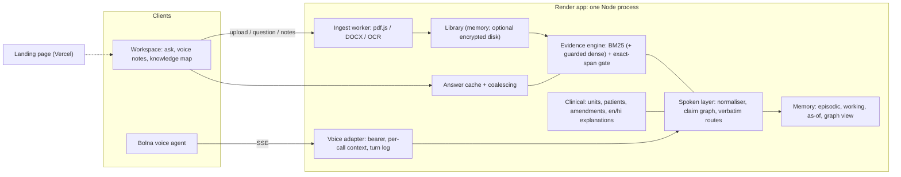

# Voice Memory

Ask your documents out loud. Every answer points to the line it came from, and
says so when something was only proposed, still pending, or never written down.

Built for the Bolna Symphony Buildathon. A deterministic evidence engine sits
behind a Bolna voice agent: no language model writes the answers.

| | |
| --- | --- |
| Landing page | https://voice-memory-beige.vercel.app (Vercel, deploys from `main`, `site/`) |
| App | https://voice-memory.onrender.com (Render free tier, owner sign-in; sleeps after 15 idle minutes) |
| Architecture and decisions | [docs/ARCHITECTURE.md](docs/ARCHITECTURE.md) |
| Medical-report market assessment | [docs/MEDICAL-MARKET.md](docs/MEDICAL-MARKET.md) |

All documents in this repository are fictional or synthetic. Do not upload real
medical or personal records to the hosted app.

## What it does

- **Answers from the record, with status.** Each value keeps its status and
  source. On the Northstar deal, $48,000 is *superseded*, $42,000 is
  *proposed, not approved*, and the 40/60 vs 50/50 split is *still open*. A
  newer record is never treated as agreed, a missing approval is never treated
  as a rejection, and an executed contract's terms count as agreed.
- **Understands how people speak.** "did they approve forty two thousand",
  "is go live moved to november third", "is there a sign contract" and
  "what's still open" work as asked. Speech notation becomes document
  notation, and nothing else is added.
- **Answers about time.** "What was the fee as of 10 September?" uses only the
  records dated on or before that day.
- **Explains lab reports simply, in the language you ask.** Answers come in
  English, Hindi or Hinglish. They are supportive and never alarming: disease
  names and false reassurance are banned by tests. Every number comes from the
  cited row. It is a research prototype on synthetic reports only.
- **Takes real files.** PDF (text layer or scanned), Word (.docx), PNG/JPEG of
  printed text, text and Markdown. Each file is parsed in a memory- and
  time-limited worker and becomes answerable only once indexing succeeds.
- **Shows the line on the page.** Citations open the original page with the
  cited line highlighted.
- **Maps how it connects.** "How this connects" under each answer is a
  knowledge map that grows with every question: topics → values → the exact
  sentences → the original page. Click a line to read the sentence behind it.
- **Takes many voice notes at once.** Record a note while others are still
  being answered. Each note is acknowledged, answers arrive in parallel and are
  spoken in order, and you can barge in.
- **Abstains plainly.** A name, amount or "private retainer" the documents
  never mention gets "I don't see that in these documents". Conversation
  cannot change a record.

## What is verified

`npm run verify` (set `CHROME_PATH` to a Chromium binary for the browser steps)
at the head of `vm2-conversation`, run on 2026-10-31:

| Suite | Result |
| --- | --- |
| Unit, normaliser, voice-lab scoring, retrieval core, memoRABLE JSON, memory guard (`npm test`) | 27/27 |
| HTTP, session, voice, cache, persistence boundaries (`npm run test:boundaries`) | 65/65 |
| Evaluation: spoken answers on 3 corpora, call isolation, longitudinal memory, public demo, landing replay (`npm run test:evaluation`) | 131/131 |
| Ingestion (`npm run test:ingest`) / clinical incl. Hindi and Hinglish tone (`npm run test:clinical`) | 19/19 · 27/27 |
| Ingestion benchmark, 22 synthetic files (`npm run bench:ingest`) | 131/131 checks |
| Voice vault: Bolna-shaped calls over HTTP (`npm run test:vault`) | all checks |
| Browser: journey, voice notes, knowledge map at desktop and phone widths | pass |

**Spoken answers through the real voice endpoint** (`npm run eval:spoken`).
Answer correctness and retrieval recall are reported separately.

| Corpus | Before 2.0 | First contact | Now | Retrieval recall |
| --- | --- | --- | --- | --- |
| Northstar, 23 spoken phrasings (development) | 11/22 | n/a | 23/23 | 14/21 |
| Harbor, 15 (held out, then used for fixes) | 3/15 | 3/15 | 15/15 | 8/13 |
| Lumen, 14 (held out; never run during development) | n/a | **12/14** | 14/14 | 10/12 |

Lumen's 12/14 is the honest generalisation number. One of its two failures was
a wrong-subject answer, since fixed. The same author wrote all three corpora,
so none is independently blind.

**Measured performance** (this machine, not the hosted instance):
- answer cache: 7.8× throughput, p95 291 → 32 ms (50 concurrent clients);
- about 4.9 ms of engine CPU per answer;
- vault first byte: p50 about 8 ms;
- BM25: 113 → 2.5 ms per query on 3,000 chunks.

## What is not proven

- **A real-microphone Bolna call.** None has been made or measured. The voice
  lab ("Measure this call") is built to measure one — speech-to-answer time by
  stage, plus recogniser errors on numbers, months and negations — but it has
  not run on a real call. The vault simulates the Bolna side only.
- **Accuracy on real documents.** Every corpus is synthetic.
- **Users and demand.** No users have been tested. The medical experiment in
  `docs/MEDICAL-MARKET.md` is designed but not run.
- **Durable storage on the hosted app.** Encrypted at-rest storage exists
  (`VM_DATA_DIR`), but Render free's disk is ephemeral.
- **Clinical use.** No clinician review. The prototype compares and explains
  what is printed; it does not diagnose.
- **Voice cost.** Only a published-price lower bound (≈$0.12 for a 2-minute
  call before telephony and platform fees). A real bill is the only proof.

## How it works



| Path | Role |
| --- | --- |
| `ingest/` | File detection, parsers, local OCR, canonical document, benchmark |
| `engine.ts`, `claim-check.ts` | Evidence engine and the generic claim vocabulary (fee/retainer, any-month dates, executed-agreement authority) |
| `spoken.mjs`, `spoken-routes.mjs`, `spoken-normalize.mjs`, `spoken-extract.mjs` | Spoken layer: intent, value verdicts, open items, document asks, documented reasons, speech normalisation, main-clause quoting |
| `memory/` | Episodic/working/as-of memory, the knowledge graph view, encrypted store |
| `clinical/` | Lab observations, comparability rules, supportive en/hi/Hinglish explanations |
| `voice-adapter.mjs` | OpenAI-compatible SSE endpoint for Bolna; per-call isolation; voice-lab turn log |
| `server.mjs`, `library.mjs`, `cache.mjs`, `dense.mjs` | HTTP server, document library, answer cache, guarded dense stage |
| `public/` | Workspace UI: answers, viewer, voice notes, knowledge map (`graph.js`), voice lab, motion primitives |
| `site/` | Landing page (static, CSP `'self'`), motion from math, replay tested equal to the engine |
| `evaluation/` | Spoken eval (3 corpora), vault, longitudinal, isolation, cost ledger, benchmarks |
| `vendor/` | Vendored IntelliRAG retrieval and memoRABLE parser |

## Run locally

```sh
npm ci
npm run build
npm start          # http://127.0.0.1:4317
```

### Configuration

| Variable | Purpose |
| --- | --- |
| `PORT`, `VM_BIND_HOST` | Listen address (default `127.0.0.1:4317`) |
| `VM_PUBLIC_HOST`, `VM_PUBLIC_ORIGIN` | The one public host/origin the UI may be reached at |
| `VM_OWNER_KEY` | Owner sign-in secret for the public host |
| `VM_VOICE_CAPABILITY`, `VM_VOICE_HARD_EXPIRES_AT`, `VM_VOICE_TTL_MS` | Fixed Bolna bearer, its absolute expiry, sliding lease |
| `VM_DEMO_BUNDLE` | `northstar` pins the fictional corpus to the voice credential at boot |
| `BOLNA_API_KEY`, `BOLNA_AGENT_ID` | Server-side Bolna web-call session minting |
| `VM_DATA_DIR`, `VM_STORE_KEY` | Encrypted at-rest storage of the owner's workspace (key: 64 hex chars; required with the dir) |
| `VM_PUBLIC_DEMO` | `1` enables an isolated synthetic demo at `/demo` (off by default) |
| `VM_DENSE`, `VM_MEMORY_LIMIT_MB` | `off` disables the embedder; memory limit override for the guard |
| `VM_PARSE_CONCURRENCY` | Parallel file parses (default 1) |
| `VM_GLOBAL_DOC_MB` | Process-wide retained-document budget in MB (default 96): originals plus parsed canonical documents (serialized size, UTF-8) across all live sessions. Pre-parse admission is a heuristic; the budget is enforced again after parsing with actual sizes and over-budget documents fail with their bytes freed. Bounds library content only, not whole-process RSS |
| `VM_PARSE_CACHE_MB` | Byte cap for the content-addressed parse cache (default 24), LRU-evicted by size and count (24) |

## Voice capability lifecycle

- One fixed bearer credential, injected by environment. No endpoint extends or
  un-retires it. Lasting revocation means rotating the value and redeploying.
- The bearer has an absolute hard expiry (`2026-11-02T00:00:00Z` on the
  buildathon deployment). Expired or retired credentials fail closed with 401.
- The bearer scopes only `POST /v1/chat/completions` and `GET /v1/models`.
- Every caller on the shared bearer is isolated: follow-ups and drafts use only
  that request's own message history.
- One live web call at a time. Each mints a single-use Bolna session
  server-side.

## Known gaps

1. A real-microphone call, measured with the voice lab (needs the owner's
   approval to spend credits).
2. Real, messy documents and independently written held-out sets.
3. User tests (medical experiment designed, not run).
4. Durable hosting for the encrypted store (a persistent disk or database).
5. English-only OCR; no handwriting, spreadsheets or legacy `.doc`.
