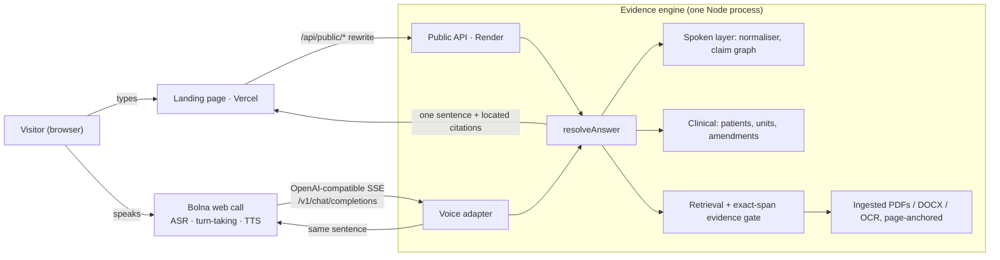

# Voice Memory

[](https://github.com/charan-rathore/voice-memory/actions/workflows/ci.yml)
[](https://github.com/charan-rathore/voice-memory/actions/workflows/canary.yml)

**The report changed. The answer shouldn't be a guess.**

Voice Memory is a voice agent on [Bolna](https://bolna.ai) that answers questions
about changing records — lab reports, contracts, meeting notes — and checks the
original source before it speaks: which report was amended, which value is only
proposed, which patient, which unit, and whether an approval was ever recorded.
Every sentence is built from the record, and the cited line opens on the
original page. An optional, capped Gemini layer can help read the question and
explain general terms; anything it proposes about the documents is verified
against the exact quoted span first (see [docs/SEMANTIC.md](docs/SEMANTIC.md)).

| | |
| --- | --- |
| **Try it** | https://voice-memory-beige.vercel.app — ask by typing (voice calling is paused for now) |
| **Memory graph** | https://voice-memory-beige.vercel.app/graph |
| Engine / API | https://voice-memory.onrender.com (Render, free tier) |
| For agents | [`llms.txt`](https://voice-memory-beige.vercel.app/llms.txt) · [OpenAPI](https://voice-memory-beige.vercel.app/openapi.json) |
| Architecture | [docs/ARCHITECTURE.md](docs/ARCHITECTURE.md) |

All patients, values and companies are fictional or synthetic. It is a research
prototype, not a diagnostic or clinically validated product.

## Why

- **68.6%** of US adults with online records opened their test results before
  hearing from a clinician, and about **1 in 3** of them understood those results
  only fairly well or poorly ([Bather et al., *JAMA Network Open*, Aug 2026](https://jamanetwork.com/journals/jamanetworkopen/fullarticle/10.1001/jamanetworkopen.2026.30698),
  HINTS 2024, n = 4,982; see also the [ASTP/ONC analysis](https://healthit.gov/blog/ai-ml/from-immediate-access-to-meaningful-delivery-a-patient-centered-approach-to-delivering-test-results/)).
- **40M+** people a day ask ChatGPT health questions, and ECRI ranks misuse of AI
  chatbots the **#1 health-technology hazard of 2026**
  ([ECRI, Jan 2026](https://home.ecri.org/blogs/ecri-news/misuse-of-ai-chatbots-tops-annual-list-of-health-technology-hazards)).
- Records change after they are first read: preliminary results are amended,
  labs switch units, proposals are revised. A fluent assistant that reads the
  newest line — or the wrong patient's — sounds confident either way.

## What it catches (live on the landing page)


<sub>Rendered with [Manim](https://github.com/ManimCommunity/manim) from
[`docs/explainer/units.py`](docs/explainer/units.py) in CI.</sub>

| Case | Question | Answer the engine gives |
| --- | --- | --- |
| Correction | "What is SYN-0001's ferritin result?" | 50 ng/mL — the 12 Oct result was corrected from 5 to 50 (amended report), cites both rows |
| Units | "Has creatinine gone up since September?" | Won't compare: 1.2 mg/dL vs 106 µmol/L, no unit conversion |
| Patients | "What is the TSH?" | Asks which patient: SYN-0001 or SYN-0003 |
| Contract | "Was the $42,000 revision finalized?" | $42,000 is the latest proposal, and it is not approved ($48,000 superseded) |
| Meeting | "Did they agree on the payment split?" | Still open: 40/60 proposed vs 50/50 discussed, not approved |
| Absence | "Is there a signed contract?" | No — the action log says no signed agreement exists |

## Bring your own documents

On the landing page, **Your documents** opens a private, short-lived workspace
(`w_` + 128-bit id, kept only in that browser tab). Upload up to 5 files
(PDF with or without a text layer, Word `.docx`, PNG/JPEG scans, text,
Markdown; 4 MB each) and ask anything, typed or on a live call:

- **Offline pipeline (per upload):** type check → parse in a memory- and
  time-limited worker (pdf.js text layer, DOCX XML, Tesseract OCR for scans)
  → a canonical document of page-anchored elements (headings, paragraphs,
  table rows with bounding boxes) → sentence/row-level chunks → BM25 index
  plus MiniLM sentence embeddings (guarded: keyword-only until warm) →
  lab-table observations (patient, unit, status) and claim extraction
  (proposed / approved / superseded / open).
- **Online pipeline (per question):** speech-notation normalisation and
  recogniser repair → hybrid retrieval (BM25 + dense rerank) → exact-span
  evidence gate → claim / clinical verdicts → one short sentence plus located
  citations; the same sentence is spoken on a call.
- **Memory graph:** the workspace gets its own graph (`/graph` → Your
  documents): lab values with corrections and comparability, and the claims
  and sentences of text documents.
- **Voice:** a call started from the Your documents tab passes the workspace
  id to Bolna as a prompt variable (`vm_ws`), so the agent answers from your
  files. Workspaces are deleted after 30 idle minutes; 12 at most at once.

## How it works



1. **Bolna** handles the call: speech recognition, turn-taking and the voice.
2. **Voice Memory** resolves the question ("forty two thousand" → $42,000,
   "it" → the field just asked about).
3. **The evidence engine** finds the original passage and checks its status —
   amended / preliminary, proposed / approved, patient, unit.
4. One short sentence goes back to Bolna to speak; the same sentence and its
   cited line appear on screen. The typed answer and the spoken answer are the
   same function (`resolveAnswer` / `leadFor`), so screen and voice never differ.

The **memory graph** (`/graph`) draws the same structure the engine answers
from: patients → reports → values → tests, with `corrects`, `supersedes`,
`competes with` and `not comparable` edges, each value linked to its exact
source sentence.

## What is verified

`npm run verify` (set `CHROME_PATH` for the browser steps). The pre-push gate
`npm run verify:fast` runs format, typecheck, unit, boundary and evaluation suites.

| Suite | Covers |
| --- | --- |
| `npm test` | unit, normaliser, retrieval core, memory guard |
| `npm run test:boundaries` | HTTP/session/voice boundaries, **public API** (`tests/public-api.test.mjs`) |
| `npm run test:evaluation` | spoken answers on 3 corpora, call isolation, longitudinal memory, **landing snapshot equals the live engine** |
| `npm run test:ingest` / `test:clinical` | PDF/DOCX/OCR ingestion; lab comparisons incl. Hindi and Hinglish |
| `npm run test:vault` | Bolna-shaped calls over HTTP |

Spoken-answer evaluation (`npm run eval:spoken`): Northstar 23/23, Harbor 15/15,
Lumen 14/14 after fixes; Lumen's first, unseen run was 12/14. All three corpora
were written by the same author.

## Ask it from code or an agent

No key needed. Demo answers are cacheable at the edge (`GET`), your own
documents use `POST` against a private workspace.

```sh
curl -s 'https://voice-memory-beige.vercel.app/api/public/answer?case=health&q=Has%20creatinine%20gone%20up%20since%20September%3F'
# {"lead":{"verdict":"NOT_COMPARABLE","text":"I can't compare your two Creatinine results: ...",
#          "citations":[{"title":"a-2026-10-amended.pdf","quote":"| Creatinine | 106 | μmol/L | 62-115 |  |", ...}]}}
```

Pass `lead.text` and its citations on as given; only `LATEST` and
`COMPARED` state a value. Full contract: [`site/openapi.json`](site/openapi.json),
summary for language models: [`site/llms.txt`](site/llms.txt).

## Staying up on a free host

The engine runs on Render's free tier, which sleeps after 15 idle minutes and
takes about a minute to wake. The page is built so a visitor rarely notices:

- **Edge-cached demo answers.** `GET /api/public/answer` returns
  `CDN-Cache-Control: s-maxage=3600, stale-while-revalidate=86400`, which
  Vercel honours on external rewrites, so repeat questions are served from
  the CDN and a stale answer is served while it revalidates
  ([Vercel: caching external rewrites](https://vercel.com/docs/routing/rewrites)).
  Demo document ids are derived from case + file name, so cached answers stay
  valid across restarts.
- **Saved answers while it wakes.** `site/snapshot.js` holds the engine's
  answers to the suggested questions; a test keeps it equal to the live engine.
- **Polite retries.** The page probes with capped exponential backoff and full
  jitter, honours `Retry-After`, and stops probing in hidden tabs
  ([AWS: Exponential Backoff and Jitter](https://aws.amazon.com/blogs/architecture/exponential-backoff-and-jitter/);
  [Brooker: backoff only helps short-term overload](https://brooker.co.za/blog/2022/08/11/backoff.html),
  which is why the cache, not retries, carries the load).
- **Graceful restarts.** Header and request timeouts against slow clients;
  `SIGTERM` drains in-flight requests before a deploy replaces the instance.
- **Continuous checks.** [`ci.yml`](.github/workflows/ci.yml) runs the whole
  gate plus a real-browser smoke test on every push;
  [`canary.yml`](.github/workflows/canary.yml) asks production the hero's
  questions every 14 minutes from 08:00 to 24:00 IST, fails if an answer drifts
  from the shipped snapshot, and keeps the engine warm within the free hours.

## Run locally

```sh
npm ci
npm run build
node scripts/site-dev.mjs     # landing + engine at http://127.0.0.1:4500
npm start                     # owner workspace (uploads, voice lab) at http://127.0.0.1:4317
```

`node scripts/build-snapshot.mjs` regenerates `site/snapshot.js` (engine answers
shown while the free host wakes up; a test keeps it equal to the live engine).

### Configuration (Render)

| Variable | Purpose |
| --- | --- |
| `BOLNA_API_KEY`, `BOLNA_AGENT_ID` | Server-side Bolna web-call minting (`/web-call/freeswitch-session`) |
| `VM_VOICE_CAPABILITY`, `VM_VOICE_HARD_EXPIRES_AT` | Bearer Bolna uses for the custom-LLM endpoint, and its absolute expiry |
| `VM_PUBLIC_CALLS_PER_IP_HOUR`, `VM_PUBLIC_CALLS_PER_DAY`, `VM_PUBLIC_CALL_GAP_MS` | Public call caps (3 / 30 / 30 s on the buildathon deploy) |
| `VM_PUBLIC_ASK_PER_MIN` | Typed-question rate limit per visitor (default 40) |
| `VM_OWNER_SIGNIN` | `off` removes the hosted owner workspace (buildathon deploy) |
| `VM_PUBLIC_HOST`, `VM_PUBLIC_ORIGIN`, `VM_LANDING_URL` | Public host and where it redirects |
| `VM_DATA_DIR`, `VM_STORE_KEY`, `VM_DENSE`, `VM_GLOBAL_DOC_MB` | Encrypted storage, dense retrieval, memory budgets |

## Repository

| Path | Role |
| --- | --- |
| `src/public-api.mjs` | Key-free landing API: cases, ask, documents, graphs, capped call minting |
| `server.mjs` / `src/server.mjs` | Stable entry point / HTTP server, workspace API, Bolna routes, case loading |
| `src/engine.ts`, `src/claim-check.ts` | Evidence engine and claim vocabulary |
| `src/spoken*.mjs` | Spoken layer: intent, verdicts, normalisation |
| `clinical/` | Lab observations, comparability, explanations (en/hi/Hinglish) |
| `src/voice-adapter.mjs` | OpenAI-compatible SSE endpoint for Bolna, per-call isolation |
| `ingest/`, `src/library.mjs` | File ingestion and page-anchored documents |
| `memory/` | Episodic memory and the knowledge-graph view |
| `site/` | Landing page, memory graph page, engine snapshot (Vercel) |
| `public/` | Local owner workspace (uploads, voice notes, voice lab) |
| `film/` | The submission film (Remotion source) |
| `evaluation/`, `tests/` | Tests and benchmarks |

## Next

- **Paraphrase-aware search.** The dense retriever exists but is not yet a
  win: on held-out paraphrases it ranks the right passage top-3 for 13 of 15,
  while the lexical evidence gate keeps shipped recall@1 at keyword level
  (0.33). Measured, and why the gate is unchanged:
  [docs/PARAPHRASE-RETRIEVAL.md](docs/PARAPHRASE-RETRIEVAL.md).
- A benchmark of real, messy records written by people outside the team
- Clinician review of lab explanations before any patient pilot
- Phone-number calls and WhatsApp voice notes through Bolna
