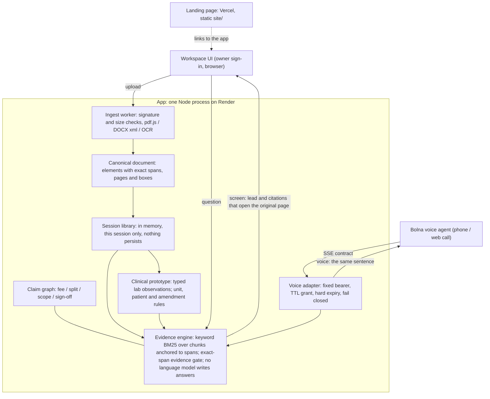

# Voice Memory

Ask your documents out loud. Every answer points to the line it came from, and
says so when something was only proposed, still pending, or never written down.

Built for the Bolna Symphony Buildathon. A deterministic evidence engine sits
behind a Bolna voice agent: no language model writes the answers.

| | |
| --- | --- |
| Landing page | https://voice-memory-beige.vercel.app (Vercel, deploys from `main`, `site/`) |
| App | https://voice-memory.onrender.com (Render free tier, owner sign-in; sleeps after 15 idle minutes) |
| Architecture and decisions | [docs/ARCHITECTURE.md](docs/ARCHITECTURE.md) |

All documents in this repository are fictional or synthetic. Do not upload real
medical or personal records to the demo: files live in session memory only.

## What it does

- **Answers from the record, with status.** Each value keeps its status and
  source: on the Northstar deal, $48,000 is *superseded*, $42,000 is *proposed,
  not approved*, the 40/60 vs 50/50 split is *still open*. Newer is never
  treated as agreed, and missing approval is never treated as rejection.
- **Takes real files.** PDF (text layer or scanned), Word (.docx), PNG/JPEG of
  printed text, text and Markdown. Files are identified by signature, parsed in a
  memory- and time-limited worker, and only become answerable once parsing and
  indexing succeed. Upload status is the real server state.
- **Shows the line on the page.** Citations open the original PDF page or image
  with the cited line highlighted, or the extracted text marked to the character.
- **Says the same thing on screen and in the call.** The screen leads with the
  exact sentence the voice agent speaks, from the same validated evidence.
- **Abstains plainly.** A name or amount the documents never mention gets "I
  don't see that in these documents". Conversation cannot change the record.
- **Compares lab results across reports (research prototype, synthetic data).**
  Lab rows become typed observations (test, comparator, value, unit, range,
  flag, patient, dates, report status). Comparisons refuse when units or
  patients differ, use the amended value when a report was corrected, keep
  `<0.05` as a bound, and never say whether a change matters clinically.

## What is verified

Run `npm run verify` (with `CHROME_PATH` pointing at a Chromium binary for the
browser step). On this branch:

| Suite | Result |
| --- | --- |
| Unit (`npm test`) | 15/15 |
| HTTP, session and voice boundaries (`npm run test:boundaries`) | 46/46 |
| Evaluation, including client call behaviour (`npm run test:evaluation`) | 110/110 |
| Ingestion, upload, anchoring, spoken answers (`npm run test:ingest`) | 19/19 |
| Clinical extraction, numeric traps, comparisons (`npm run test:clinical`) | 17/17 |
| Ingestion benchmark, 22 synthetic files, hand-written gold (`npm run bench:ingest`) | 131/131 checks |
| Browser journey at 1440, 390 and 320 px (`npm run test:browser`) | pass |

Retrieval baseline (`npm run bench:retrieval`, 30 questions, keyword/BM25):
Recall@3 is 0.91 on literal questions and **0.29 on paraphrased ones**. That gap
is the measured case for semantic retrieval; it is not built yet.

Verified live on the deployed service (2026-10-31, server to server over the
voice SSE contract): supersession and "not approved" answers, exact quotes,
abstention on forged authority and on another client's corpus, and 401/403 on
wrong or missing credentials.

## What is not proven

- **A real-microphone Bolna call** on a physical device has not been recorded.
  The media path is wired but unproven on real hardware.
- **Accuracy on real documents.** Every benchmark file is synthetic and
  machine-generated; real scans and real lab layouts are not covered.
- **Semantic search.** Retrieval is keyword-only; paraphrases mostly miss.
- **Fitness for real health or personal data.** Storage is in-memory, with no
  encryption at rest, audit log or retention policy. No compliance is claimed.
- **Clinical use.** The lab comparison is a research prototype on synthetic
  reports. It extracts and compares what is printed; it does not interpret.

## How it works



| Path | Role |
| --- | --- |
| `ingest/` | File detection, PDF/DOCX/image/text parsers, local OCR, canonical document, benchmark |
| `engine.ts` | Evidence engine: import, chunk anchoring, retrieval, evidence validation, claim checks |
| `claim-check.ts`, `spoken.mjs` | Commercial claim graph (fee, split, scope, sign-off) and its spoken renderer |
| `spoken-extract.mjs` | Spoken answer outside claim fields: one verbatim sentence or table row |
| `clinical/` | Lab observation model, comparability rules, lab answers, synthetic fixtures |
| `library.mjs` | Session document library: staged uploads, review gate, located citations |
| `server.mjs` | HTTP server: owner session, CSRF, uploads, queries, Bolna session mint |
| `voice-adapter.mjs` | OpenAI-compatible SSE endpoint Bolna calls, bearer lifecycle |
| `public/` | Workspace UI (documents rail, answers, source viewer, talk pill) |
| `site/` | Landing page (static, self-hosted fonts, CSP `'self'` only) |
| `vendor/` | Vendored IntelliRAG retrieval and memoRABLE parser source |

## Run locally

```sh
npm ci
npm run build
npm start          # http://127.0.0.1:4317
```

Optional fixture rebuilds: `npm run fixtures:build` (ingestion; needs Chromium
and qpdf) and `npm run fixtures:clinical`. Fixtures are committed so the
benchmarks run against frozen files.

### Configuration

| Variable | Purpose |
| --- | --- |
| `PORT`, `VM_BIND_HOST` | Listen address (default `127.0.0.1:4317`) |
| `VM_PUBLIC_HOST`, `VM_PUBLIC_ORIGIN` | The one public host/origin the UI may be reached at |
| `VM_OWNER_KEY` | Owner sign-in secret for the public host |
| `VM_VOICE_CAPABILITY` | Fixed bearer the Bolna agent uses for `/v1/chat/completions` |
| `VM_VOICE_HARD_EXPIRES_AT` | Absolute expiry of that bearer (ISO-8601 or epoch ms) |
| `VM_VOICE_TTL_MS` | Sliding voice grant lease (default 10 minutes) |
| `VM_DEMO_BUNDLE` | `northstar` pins the fictional demo corpus to the voice credential at boot |
| `BOLNA_API_KEY`, `BOLNA_AGENT_ID` | Server-side Bolna web-call session minting |
| `VM_PARSE_CONCURRENCY` | Parallel file parses (default 1; OCR peaks near 276 MB) |

## Voice capability lifecycle

- One fixed bearer credential, injected by environment. No endpoint extends or
  un-retires it. The owner's session reset retires it for the life of the
  process; lasting revocation means rotating the value and redeploying.
- The bearer has an absolute hard expiry (`2026-11-02T00:00:00Z` on the
  buildathon deployment); expired or retired credentials fail closed with 401.
- The bearer scopes only `POST /v1/chat/completions` and `GET /v1/models`.
  Every other route stays behind the owner sign-in, session cookie and CSRF.
- In pinned demo mode uploads never retarget the Northstar credential. Outside
  demo mode, removing a document retargets the credential at once; with no
  documents left it answers 401.
- One live call at a time; each call mints a single-use Bolna session
  server-side, with a 45-second setup watchdog.

The local engine makes no model API calls. Voice calls run through Bolna and
spend the account's credits.

## Known gaps

Ranked, with plans in [docs/ARCHITECTURE.md](docs/ARCHITECTURE.md):

1. A real-microphone call recording.
2. A gold set of real, messy documents (scans, real lab layouts).
3. Semantic retrieval, adopted only if it beats the BM25 baseline above.
4. Durable, encrypted storage with deletion and audit.
5. The claim renderer can answer a "what" question with "No." (seen on the
   fictional sample: "What is pending for the security review?").
6. English-only OCR; no handwriting, spreadsheets or legacy `.doc`.
