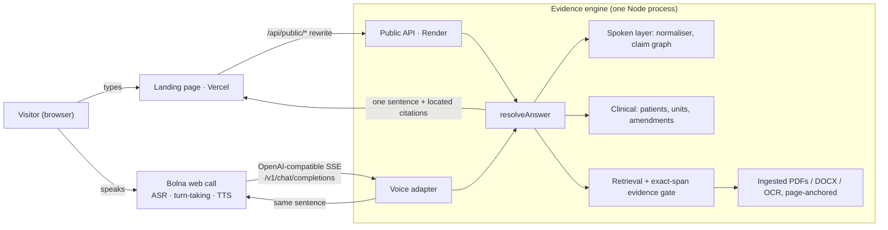

# Voice Memory

**The report changed. The answer shouldn't be a guess.**

Voice Memory is a voice agent on [Bolna](https://bolna.ai) that answers questions
about changing records — lab reports, contracts, meeting notes — and checks the
original source before it speaks: which report was amended, which value is only
proposed, which patient, which unit, and whether an approval was ever recorded.
No language model writes the answers. Every sentence is built from the record,
and the cited line opens on the original page.

| | |
| --- | --- |
| **Try it** | https://voice-memory-beige.vercel.app — ask by typing or start a live Bolna call |
| **Memory graph** | https://voice-memory-beige.vercel.app/graph |
| Engine / API | https://voice-memory.onrender.com (Render, free tier) |
| Architecture | [docs/ARCHITECTURE.md](docs/ARCHITECTURE.md) |

All patients, values and companies are fictional or synthetic. It is a research
prototype, not a diagnostic or clinically validated product.

## Why

- **68.6%** of US adults with online records opened their test results before
  hearing from a clinician, and about **1 in 3** of them understood those results
  only fairly well or poorly ([Bather et al., *JAMA Network Open*, Aug 2026](https://jamanetwork.com/journals/jamanetworkopen/fullarticle/10.1001/jamanetworkopen.2026.30698),
  HINTS 2024, n = 4,982; see also the [ASTP/ONC analysis](https://healthit.gov/blog/ai-ml/from-immediate-access-to-meaningful-delivery-a-patient-centered-approach-to-delivering-test-results/)).
- **40M+** people a day ask ChatGPT health questions, and ECRI ranks misuse of AI
  chatbots the **#1 health-technology hazard of 2026**
  ([ECRI, Jan 2026](https://home.ecri.org/blogs/ecri-news/misuse-of-ai-chatbots-tops-annual-list-of-health-technology-hazards)).
- Records change after they are first read: preliminary results are amended,
  labs switch units, proposals are revised. A fluent assistant that reads the
  newest line — or the wrong patient's — sounds confident either way.

## What it catches (live on the landing page)

| Case | Question | Answer the engine gives |
| --- | --- | --- |
| Correction | "What is SYN-0001's ferritin result?" | 50 ng/mL — the 12 Oct result was corrected from 5 to 50 (amended report), cites both rows |
| Units | "Has creatinine gone up since September?" | Won't compare: 1.2 mg/dL vs 106 µmol/L, no unit conversion |
| Patients | "What is the TSH?" | Asks which patient: SYN-0001 or SYN-0003 |
| Contract | "Was the $42,000 revision finalized?" | $42,000 is the latest proposal, and it is not approved ($48,000 superseded) |
| Meeting | "Did they agree on the payment split?" | Still open: 40/60 proposed vs 50/50 discussed, not approved |
| Absence | "Is there a signed contract?" | No — the action log says no signed agreement exists |

## How it works



1. **Bolna** handles the call: speech recognition, turn-taking and the voice.
2. **Voice Memory** resolves the question ("forty two thousand" → $42,000,
   "it" → the field just asked about).
3. **The evidence engine** finds the original passage and checks its status —
   amended / preliminary, proposed / approved, patient, unit.
4. One short sentence goes back to Bolna to speak; the same sentence and its
   cited line appear on screen. The typed answer and the spoken answer are the
   same function (`resolveAnswer` / `leadFor`), so screen and voice never differ.

The **memory graph** (`/graph`) draws the same structure the engine answers
from: patients → reports → values → tests, with `corrects`, `supersedes`,
`competes with` and `not comparable` edges, each value linked to its exact
source sentence.

## What is verified

`npm run verify` (set `CHROME_PATH` for the browser steps). The pre-push gate
`npm run verify:fast` runs format, typecheck, unit, boundary and evaluation suites.

| Suite | Covers |
| --- | --- |
| `npm test` | unit, normaliser, retrieval core, memory guard |
| `npm run test:boundaries` | HTTP/session/voice boundaries, **public API** (`public-api.test.mjs`) |
| `npm run test:evaluation` | spoken answers on 3 corpora, call isolation, longitudinal memory, **landing snapshot equals the live engine** |
| `npm run test:ingest` / `test:clinical` | PDF/DOCX/OCR ingestion; lab comparisons incl. Hindi and Hinglish |
| `npm run test:vault` | Bolna-shaped calls over HTTP |

Spoken-answer evaluation (`npm run eval:spoken`): Northstar 23/23, Harbor 15/15,
Lumen 14/14 after fixes; Lumen's first, unseen run was 12/14. All three corpora
were written by the same author.

## Run locally

```sh
npm ci
npm run build
node scripts/site-dev.mjs     # landing + engine at http://127.0.0.1:4500
npm start                     # owner workspace (uploads, voice lab) at http://127.0.0.1:4317
```

`node scripts/build-snapshot.mjs` regenerates `site/snapshot.js` (engine answers
shown while the free host wakes up; a test keeps it equal to the live engine).

### Configuration (Render)

| Variable | Purpose |
| --- | --- |
| `BOLNA_API_KEY`, `BOLNA_AGENT_ID` | Server-side Bolna web-call minting (`/web-call/freeswitch-session`) |
| `VM_VOICE_CAPABILITY`, `VM_VOICE_HARD_EXPIRES_AT` | Bearer Bolna uses for the custom-LLM endpoint, and its absolute expiry |
| `VM_PUBLIC_CALLS_PER_IP_HOUR`, `VM_PUBLIC_CALLS_PER_DAY`, `VM_PUBLIC_CALL_GAP_MS` | Public call caps (3 / 30 / 30 s on the buildathon deploy) |
| `VM_PUBLIC_ASK_PER_MIN` | Typed-question rate limit per visitor (default 40) |
| `VM_OWNER_SIGNIN` | `off` removes the hosted owner workspace (buildathon deploy) |
| `VM_PUBLIC_HOST`, `VM_PUBLIC_ORIGIN`, `VM_LANDING_URL` | Public host and where it redirects |
| `VM_DATA_DIR`, `VM_STORE_KEY`, `VM_DENSE`, `VM_GLOBAL_DOC_MB` | Encrypted storage, dense retrieval, memory budgets |

## Repository

| Path | Role |
| --- | --- |
| `public-api.mjs` | Key-free landing API: cases, ask, documents, graphs, capped call minting |
| `server.mjs` | HTTP server, workspace API, Bolna routes, case loading |
| `engine.ts`, `claim-check.ts` | Evidence engine and claim vocabulary |
| `spoken*.mjs` | Spoken layer: intent, verdicts, normalisation |
| `clinical/` | Lab observations, comparability, explanations (en/hi/Hinglish) |
| `voice-adapter.mjs` | OpenAI-compatible SSE endpoint for Bolna, per-call isolation |
| `ingest/`, `library.mjs` | File ingestion and page-anchored documents |
| `memory/` | Episodic memory and the knowledge-graph view |
| `site/` | Landing page, memory graph page, engine snapshot (Vercel) |
| `public/` | Local owner workspace (uploads, voice notes, voice lab) |
| `film/` | The submission film (Remotion source) |
| `evaluation/`, `*.test.mjs` | Tests and benchmarks |

## Next

- Bring-your-own documents on the landing page, in an encrypted private workspace
- Paraphrase-aware retrieval (dense stage behind the same evidence gate)
- A benchmark of real, messy records written by people outside the team
- Clinician review of lab explanations before any patient pilot
- Phone-number calls and WhatsApp voice notes through Bolna
