# Companion voice, vernacular understanding, drill-down charts (2026-11-02)

What changed on branch `ux-companion-upgrade` (stacked on `readout-sarvam`),
what was measured, and what is deliberately not claimed. Nothing here is
clinical validation, and no real Sarvam or ElevenLabs call has been made yet
(see section 6).

## 1. The four problems this starts from

| Problem (from the brief and the screenshots)                   | What it was on `readout-sarvam`                                                                                                                             |
| --------------------------------------------------------------- | ----------------------------------------------------------------------------------------------------------------------------------------------------------- |
| The answer's Listen voice sounds robotic                        | `speechSynthesis` in the browser for every answer (only the overview board had moved to Sarvam)                                                            |
| Hindi and Hinglish are understood unevenly                      | 27/55 on a new vernacular set: Hinglish deal answers in Devanagari, Hindi deal answers in English, "42 hazaar wala final hua?" unanswered, IDs said as words lost |
| "When to say no" is not explicit                                | "Should I take iron tablets?" asked which patient; "Do I have diabetes?" read out the HbA1c                                                                  |
| The hero's 5 could stay parked over the amended card            | a timeline callback scheduled exactly at its end could be skipped; `site-shots` failed intermittently with "the 5 never landed"                              |

Two existing bugs surfaced on the way and are fixed: the test-name repair
turned "corrected" into "Creatinine" (so "Why was the ferritin corrected?"
answered about creatinine), and `tests/site-check.mjs` expected a text
`<mark>` where the viewer now draws a box over the PDF page (it failed on
`main` too; CI never got that far because `format:check` failed first, which
is also fixed).

## 2. Architecture

```mermaid
flowchart LR
    M["Mic (press to talk)"] -->|clip, consented| STT["Voice in<br/>Sarvam Saaras v3 (codemix)<br/>then ElevenLabs Scribe v2 (keyterms)<br/>then Gemini"]
    M -->|live words| BR["Browser recogniser<br/>(interim text only)"]
    STT --> REP["Repair against the case<br/>spoken IDs, test names it holds"]
    BR --> Q["Question"]
    REP --> Q
    T["Typed"] --> Q
    Q --> V["Vernacular front-end<br/>self-corrections, one spelling,<br/>Hindi numbers, IDs"]
    V --> A{"Advice?<br/>treatment, diagnosis,<br/>decision"}
    A -->|yes| D["Clear, warm decline<br/>in the visitor's language"]
    A -->|no| E["Evidence engine (unchanged)<br/>claim graph, clinical, hybrid retrieval,<br/>exact-span gate, semantic rescue"]
    E --> L["Render in the asked language<br/>Hindi: Devanagari, Hinglish: romanised"]
    L --> O["Companion opener<br/>(no facts, tested)"]
    D --> S["Screen: opener + answer + cited line"]
    O --> S
    S -->|Listen| TTS["Voice out<br/>Sarvam Bulbul, then ElevenLabs<br/>one sentence at a time, words lit"]
```

**Voice out** (`src/voice-providers.mjs`, `src/sarvam-tts.mjs`,
`POST /api/public/speak`, `site/listen.js`). The client sends the
question, never text: the server re-resolves the answer (an answer-cache
hit) and speaks its own opener and sentence, so the route cannot become a
free text-to-speech proxy. Sentences are spoken one at a time with the next
prefetched, and each word is lit as it is said (ElevenLabs character
timestamps when present, a length-weighted estimate for Sarvam). Providers
are tried in `VM_TTS_ORDER`; credits (402), rate limits (429) and outages
hand over to the next, a bad request does not bill a second provider.
There is no browser-voice fallback on the public Listen path (the decision
from `readout-sarvam`, extended to answers): if the voice is down the button
says so and the answer stays on screen. A visitor's own documents are sent
to the provider only after an explicit, per-tab yes.

**The companion opener** (`src/companion.mjs`). "Honest answer:", "Quick
check before I answer.", "Dekhiye, report mein yeh likha hai." One per
verdict and language, picked by a stable hash so the same answer always
opens the same way (cacheable audio). Three rules, all tested: an opener
carries no fact (no digits, test names or status words), it never cheers or
alarms ("good news", "don't worry"), and it is shown on screen as well as
spoken, so screen and voice are still the same words.

**Voice in** (`/api/public/transcribe`). Sarvam Saaras v3 in `codemix` mode
keeps English test names in Latin script inside Hindi speech ("मेरा ferritin
कितना है"), which is what the engine and the repair step read. ElevenLabs
Scribe v2 gets the case's vocabulary as keyterms (names, IDs, never values).
Gemini stays as the last fallback, the browser recogniser as the floor. The
transcript is then repaired only where the case says so (spoken IDs, test
names the reports hold), and the raw words travel back so the dictation
status can show "heard 'ferrite in'". The consent text names the providers
actually configured, and its storage key moved to v2 so earlier
Gemini-only yeses are asked again.

**Vernacular front-end** (`src/vernacular.mjs`). Deterministic, dictionary
based, every rewrite testable: self-corrections ("the fee, no sorry, the
deadline" keeps the frame and the correction), one spelling per romanised
word (pichli / pichle / picchli, jyada / zyaada, manjoor / manzur), Hindi
number words in both scripts ("bayalis hazaar", "बयालीस हज़ार" to 42000),
spoken IDs ("syn zero zero zero three", "sin double zero zero one"). Language
detection now weighs question words and verbs above postpositions and reads
Hindi's verb-final order, so "SYN-0001 ka TSH" and "ferrite in result batao"
are Hinglish while "Is Mera a name?" stays English. Deal answers are
rendered from the engine's fixed English templates into Devanagari for
Hindi and romanised Hindi for Hinglish (`toHinglish`, new), with record text
and values verbatim.

**Saying no** (`adviceKind`, `declineLead`). Treatment ("should I take /
stop", "goli leni chahiye", "दवा लेनी चाहिए", doses), diagnosis ("do I have
diabetes", "kya mujhe anemia hai", only with a named condition, so "do I
have a ferritin result?" is still a lookup) and decisions that belong to the
visitor ("should we sign") are declined before retrieval, so a nearby value
can never be read out as if it were advice. The decline is one warm,
unhedged paragraph that names the doctor (or the team) and says what the
assistant can do instead. Verdict `DECLINE_ADVICE`, no citations, no
numbers (tested).

**Confirming before answering.** The existing grounded-search path
(`src/semantic/`, Gemini + Google Search on generic terms only, consent
gated, capped) remains the "check it first" layer for general background,
kept apart from document facts with its sources. This branch does not add
a second search provider: the evidence gate decides what the documents say,
and web knowledge is only ever labelled background.

**Retrieval.** Hybrid BM25 + bge-small with RRF and contextual paraphrase
units was already in place. Added: a cross-lingual bridge (a Hindi or
Hinglish question over English documents also searches the English words
for its domain terms, retrieval only, the exact-span gate unchanged) and an
experiment, contextual chunk headers for the dense side
(`VM_DENSE_CONTEXT=on`). The experiment measured worse and ships off (see
section 4). `bench.yml` now runs the hybrid bench twice on the same runner
on every retrieval PR, so each change is judged against its own baseline.

**Drill-down charts** (`insightOf` in `src/visual-summary.mjs`,
`site/visual.js`). Every strip opens the test the way an analytics tool
opens a metric: every reading on a timeline against the lab's band
(labelled log axis when readings are 20x apart, a torn gap and no shared
axis when units differ, corrected values as struck ghosts with the
correction arrow), tiles for the change since last time, the distance to
the printed range and the number of readings, each reading's source line
one click away (it opens the page in the viewer), and the questions worth
asking next. The numbers come from the engine's own `compare()`: a change
only between comparable readings (same unit, exact numbers, corrected values
never count), precision no finer than the printed values, otherwise a reason
instead of a number.

**Landing.** The hero card tells three real answers, each in the language
it was asked (correction in English, units in Hinglish, approval in Hindi),
with story tabs and their own progress clock; `site-snapshot.test.mjs`
checks each story's words are the engine's output for its question. How it
works became four moving pictures (transcript with fillers struck, words
mapping to meanings, the record's checks ticking, the answer lit word by
word), equal height, still under reduced motion.

## 3. Prior art, and what was taken from it

The two X posts in the brief could not be read from this environment
(x.com refuses automated fetches), so they are not reflected here.

| Source                                                                                                                                         | Architecture                                                                                                                         | Taken                                                                                                       | Not taken, and why                                                                                                    |
| ---------------------------------------------------------------------------------------------------------------------------------------------- | ------------------------------------------------------------------------------------------------------------------------------------ | ----------------------------------------------------------------------------------------------------------- | --------------------------------------------------------------------------------------------------------------------- |
| SETU-RAG (Juvale, ISI Kolkata, 2026): code-switching-aware multilingual RAG                                                                    | routes retrieval by the query's Code-Mixing Index and matrix language; corrective (CRAG) and faithfulness (Self-RAG) gates; a speech layer with language-ID fusion and code-mix-conditioned TTS | routing by linguistic profile (front-end before retrieval), language-matched voice out                      | LLM-based corrective gates: the exact-span evidence gate already plays that role deterministically                   |
| Hindi voice agents on Sarvam (Saaras + Bulbul) write-ups                                                                                      | STT in codemix, an LLM, Bulbul for Hinglish TTS in one pass                                                                          | Saaras `codemix` for input, Bulbul as the first voice                                                       | free LLM replies in Hinglish: answers here come from the engine, only the opener is templated                        |
| SmartDocs multilingual agentic RAG (r/Rag, 2026)                                                                                              | Indic-aware tokenisation, NFKC at ingest, deterministic routing, multi-query expansion, hybrid E5 + BM25 with RRF                  | deterministic routing, a query-side bridge instead of a multilingual embedder                               | a heavier multilingual embedder: the free host's memory budget (see `dense.mjs`)                                    |
| Anthropic contextual retrieval (Sept 2024): context prepended to chunks, contextual BM25 + embeddings, RRF; reported 35% / 49% fewer retrieval failures | per-chunk LLM context                                                                                                                | the deterministic flavour (title + heading path), as an A/B experiment                                       | shipping it: it measured worse on this corpus (section 4)                                                            |
| KnowGuard (ICLR 2026) and "Knowing When to Abstain" (EACL 2026)                                                                               | investigate before abstaining; explicit abstention options increase safe abstention                                                 | an explicit decline route that fires before retrieval, and abstention cases in every eval set                | model self-confidence as the abstention signal                                                                       |
| ElevenLabs Scribe v2 / TTS with timestamps, Sarvam Saaras v3 / Bulbul REST references                                                        | keyterm prompting; character alignment; codemix and auto language detection                                                          | request shapes in `voice-providers.mjs`, tested against mocked fetch                                        | streaming WebSockets: one-sentence REST calls keep the route simple and cacheable; streaming is the next latency lever |

Design references: Cardboard's landing (three tall product-fragment cards
with a title and two lines under each, and a numbered section whose bullets
switch a large visual), Linear and Raycast (tabs with a progress clock,
command-bar ask pill, quiet motion that carries information).

## 4. Measurements

All with `VM_GEMINI` unset (deterministic engine), local, same author as the
code (not independent).

| Set                                                    | Before (`readout-sarvam`) | After         | Notes                                                                                       |
| ------------------------------------------------------ | ------------------------- | ------------- | ------------------------------------------------------------------------------------------- |
| Vernacular development (`vernacular.json`, 55 + 5)     | 27/55, abstention 4/5     | 55/55, 5/5    | development data: fixes were made against these failures                                   |
| Vernacular held-out (`vernacular-heldout.json`, 22 + 2) | 11/22, abstention 1/2     | **20/22**, 2/2 | written before running, run once frozen, no changes in response; zero critical failures     |
| Semantic development (`cases.json`)                    | 40/41                     | 41/41         | h04 was the "corrected" -> Creatinine bug                                                   |
| Semantic held-out (`heldout.json`)                     | 20/20                     | 20/20         | unchanged                                                                                   |
| Hybrid retrieval, bare chunks (CI, bge-small)          | R@3 0.87, MRR 0.81        | same (default) |                                                                                            |
| Hybrid retrieval, contextual chunk headers (CI)        |                           | R@3 0.83, MRR 0.79 | worse by one literal question; shipped off                                              |

The two held-out misses, recorded as they were: "kya mujhe thyroid ki
problem hai" asked which patient instead of declining ("problem" without
"disease" is not in the condition list), and "42 thousand wala revision
approve ho gaya?" got no answer (an English number word with a Hindi frame
is not converted). Both are now known, neither is fixed on this branch, so
the held-out number stays honest. `evaluation/vernacular.test.mjs` gates
CI on the development set staying complete and the held-out set not
dropping below 20/22, with zero critical failures.

## 5. Configuration (Render environment, never in Git or `site/`)

| Variable                                 | Default                              | What it does                                                 |
| ---------------------------------------- | ------------------------------------ | ------------------------------------------------------------ |
| `VM_SARVAM_API_KEY`                      | unset                                | Sarvam Bulbul voice out and Saaras voice in                   |
| `ELEVENLABS_API_KEY`                     | unset                                | ElevenLabs voice out (timestamps) and Scribe voice in         |
| `VM_TTS_ORDER` / `VM_STT_ORDER`          | `sarvam,elevenlabs`                  | provider order                                               |
| `VM_SARVAM_MODEL`, `VM_SARVAM_SPEAKER`, `VM_SARVAM_PACE` | `bulbul:v4-flash`, per language, `0.95` | Bulbul model, persona, pace                               |
| `VM_SARVAM_STT_MODEL`                    | `saaras:v3`                          |                                                              |
| `VM_ELEVEN_MODEL`, `VM_ELEVEN_VOICE`, `VM_ELEVEN_STT_MODEL` | `eleven_multilingual_v2`, a stock voice, `scribe_v2` |                                              |
| `VM_SPEAK_PER_IP_DAY`, `VM_SPEAK_GLOBAL_PER_DAY` | 80, 800                      | answer sentences synthesised (cache hits are free)           |
| `VM_NARRATE_*`                           | as on `readout-sarvam`               | overview narration caps                                      |
| `VM_DENSE_CONTEXT`                       | unset (off)                          | `on` embeds chunks with title + heading (experiment)         |
| `VM_TTS_FAKE`                            | unset                                | `on`: a local tone for browser tests only                    |

`/api/public/status` reports `voiceOut.providers` and
`semantic.transcribeProviders` (never a key). The Listen button appears only
when a voice is configured.

## 6. Verified, and not verified

Verified here: every unit, boundary, evaluation, clinical and vault suite;
the vernacular, semantic and held-out sets above; the drill-down, Listen
flow (with the local tone provider), hero stories and how-it-works in a real
Chromium on desktop and phone; the bring-your-own-documents browser check;
format and types.

Not verified, and not claimed:

- **No real Sarvam or ElevenLabs request has been made.** This environment
  has no keys and its network allowlist blocks both hosts. The adapters are
  written to the published REST references and tested against mocked fetch;
  the first real call may need a field adjusted. Voice quality, latency and
  cost per answer are unmeasured.
- The Vercel preview of this PR serves the new landing against the
  production engine on Render, which runs `main`: the new routes (`/speak`,
  provider-chain `/transcribe`, `DECLINE_ADVICE`, Hinglish rendering) are not
  live there until the engine deploys this branch.
- Bolna calls, Gemini and the call-allowance paths are untouched.
- The held-out sets share an author with the code; they are not an
  independent evaluation, and nothing here is clinical validation.
