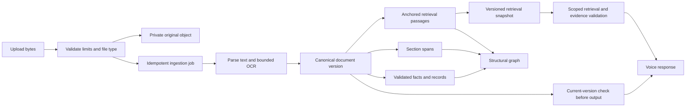

# Durable, source-grounded document memory

Status: architecture proposal following the November 6 audit. The current branch fixes workspace recovery, source identity, structural graph generation and scoped voice boundaries. It does **not** introduce a durable database, background job platform or provider-based semantic ingestion.

## One canonical version, several projections

Original bytes, canonical text, parsed records, graph projections and embeddings have different lifecycles. A filename is a label; a content hash is a version fingerprint; neither is a tenant or document identity. The public demo's opaque workspace identifier is a temporary capability, not a complete account/authorization system.

## Proposed storage contract

| Record | Key and essential fields | Invariant |
| --- | --- | --- |
| Workspace | owner, workspace ID, retention policy, current snapshot | Every read/write checks ownership or an explicitly scoped capability |
| Document | workspace ID, document ID, title, original-object reference | Adding a second identical file does not merge distinct document identities |
| Document version | document ID, version ID, source hash, parser/OCR versions, canonical text, status | Published canonical text is immutable |
| Ingestion job | workspace/document/version, idempotency key, attempt, stage, error, heartbeat | Retries cannot publish duplicate documents or regress a newer version |
| Passage | version ID, passage ID, ordinal, start/end, content hash, heading metadata | Citation quote is exactly canonical text sliced by the stored span |
| Section | version ID, section ID, label, start/end | A passage may intersect several sections; duplicate headings stay distinct |
| Structural edge | version ID, from/to, relationship, source spans | Contains/overlaps/next-in-document never implies semantic agreement or causality |
| Fact edge | version ID, typed fact, source span, extraction method, review state | An inferred relationship cannot masquerade as an explicit source claim |
| Retrieval snapshot | workspace ID, snapshot ID, document-version set, indexing versions | Readers see one atomically published set of versions |
| Voice binding | opaque call ID, workspace, expiry, capability generation | Unknown/expired calls cannot select scope from a fallback prompt |

Keep originals in private object storage and metadata/projections in a transactional store. Do not duplicate large binary payloads into every passage or graph node. Encryption keys, retention and deletion policy must be configured before enabling persistence for personal documents. No live personal documents should be migrated by an unreviewed prototype.

## Publish and recovery sequence

1. Validate type, byte/page/text limits and workspace quota before scheduling expensive work. Acknowledge the upload with a durable document/job ID.
2. Store the original privately, then parse/OCR in a bounded worker. Persist stage transitions and errors so refresh/restart can resume the same job.
3. When early text is useful, publish a clearly provisional version. Never silently splice later OCR offsets into an already published version.
4. Derive passages, section spans, graph edges and validated facts from that exact canonical version. Verify offsets, source hashes, graph endpoints and document ownership.
5. Commit the new version set and snapshot pointer atomically. A stale retry cannot replace a newer successful snapshot.
6. Notify/revalidate UI consumers; selected passages removed by a new version fall back to their document, with changed-state messaging.
7. On query, retrieve within the authorized snapshot. Before emitting a spoken answer, recheck call binding, workspace readiness, version and capability validity. If they changed, refuse/retry rather than speak stale facts.
8. Delete originals, canonical versions, derived projections, cached replays and embeddings according to the same retention/deletion contract.

## Caching rules

- Parse cache keys include content fingerprint, parser version, OCR language/model and normalization policy. Cache OCR confidence and review metadata with the text. Partition by privacy boundary unless cross-tenant reuse is explicitly safe and authorized.
- Embedding keys include canonical passage content, model, dimensions, dtype and preprocessing version. Reuse unchanged passages within the same source/workspace without treating hashes as access control.
- Retrieval-index caches invalidate when the snapshot/version set changes. The current implementation already uses corpus fingerprints and weak references; durable caching must preserve those correctness rules.
- Answer cache keys additionally include workspace/snapshot, normalized question, language, model/configuration and consent/audience policy. A consented provider answer must never become an unconsented cache hit.
- Spoken replay uses a server-owned call/workspace/source-version binding. Client assistant-history text cannot create a replay record. Bound bytes as well as entries; never truncate a sentence into a potentially misleading replay.

## Acceptance tests before persistent release

Crash/restart during each stage; duplicate requests and retries; upload cancellation/deletion; idle and absolute expiry; concurrent replacement; OCR inserted before existing text; repeated headings/paragraphs; headingless notes; table provenance; conflicting facts; identical files in different workspaces; late graph/answer responses; revoked or expired calls; cross-caller repeats; provider timeout/budget denial; retained/private data deletion. Test voice end-to-end with a unique synthetic uploaded fact and real consented transport before claiming microphone/ASR/provider latency or accuracy.

A larger graph alone will not solve paraphrase retrieval. Freeze an independently authored mixed-domain evaluation set with absent-fact, wrong-entity, negation and conflicting-source controls; measure the complete product answer path and citation validity, not only raw candidate recall.

## Speed and trust pass (November 2026)

Measured with `scripts/measure-journey.mjs` (real fixture reports through the
public API; results in `evaluation/results/journey-*.json`). Local machine;
the Render free host has about 0.1 CPU, so multiply server CPU seconds by
about 10 for production wall time.

| Five reports (4 digital + 1 three-page mixed scan) | Before | After |
| --- | --- | --- |
| Server CPU per batch | about 1.5 s for an earlier five-file set with one scanned page (worker per file) | 0.33 s for that same set; 0.99 s for this set with two OCR pages |
| Digital report answerable after upload | not recorded | 0.03 to 0.14 s |
| Question to answer | not recorded | 5 to 44 ms |
| Same question asked 20 times | not checked | identical words every time (7 questions) |
| Phone turn (OpenAI-compatible endpoint Bolna calls) | not measured | 10 to 28 ms to first word, server side |

What was slow, and the fix:

- **A new worker thread and a fresh pdf.js per file** (about 260 ms of boot
  each). Now a warm pool of parser threads (`ingest/pool.mjs`, size
  `VM_PARSE_CONCURRENCY`, default 2) is reused across files; a thread that
  overruns is killed and replaced, as before.
- **The OCR engine reloaded per file.** The warm thread keeps its engine
  while a batch is in flight and still holds the one OCR permit, so two OCR
  engines never run at once on a 512 MB host.
- **The dense model loaded at fp32 (about 360 MB)**, which forced a pause
  and reload on every upload. It now loads 8-bit (`VM_DENSE_DTYPE`, default
  `q8`, about 160 MB). CI's dense thresholds decide whether this stays.

### Is a database needed for speed?

No. Parsing, OCR and indexing are CPU-bound; none of the time above is spent
reading or writing state. A database would make documents survive a restart
(Render's free disk is wiped on deploy), which is a durability feature, not
a speed one, and it needs a new provider and infrastructure approval. The
storage contract above is the plan for when that is approved.

### Scans: read right, or say which page to check

- OCR words are laid out with the same reading-order and table engine as the
  PDF text layer, after straightening a tilted page, so columns stay columns.
- Every scanned page gets its own confidence, and the warning, the progress
  view and the answer quote the same number. A blurry page 3 does not cast
  doubt on digital pages 1 and 2.
- A value is marked **unclear** (never stated) when OCR probably dropped a
  decimal (68 printed where the range is 0.4 to 4.0 and 6.8 fits) or read a
  unit no lab prints. The answer names the page to check, and the summary and
  doctor questions list it separately from "no printed range".
- Test fixture: `evaluation/scans/mixed-quality.pdf` (fictional SYN-0007),
  checked by `clinical/scan-safety.test.mjs`.

### Not measured here

A real phone call's latency (Bolna's speech-to-text, network, and speech
synthesis) needs a live call; the server-side figure above is the part
Voice Memory controls.
